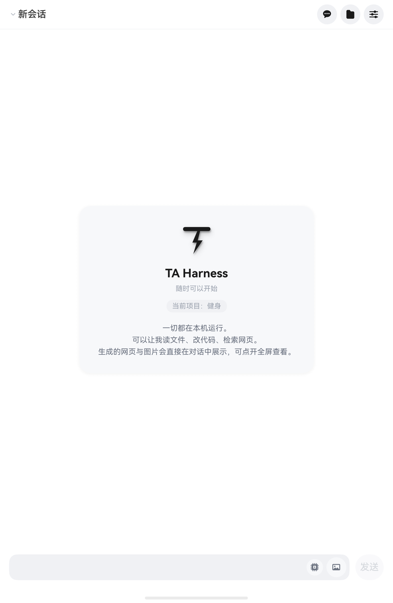
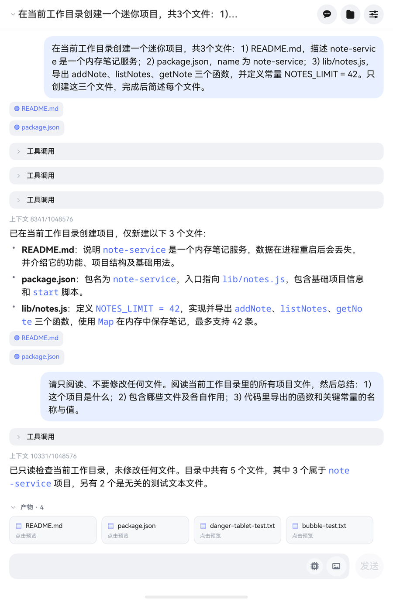

<div align="center">

# TA Harness

**在鸿蒙设备上本地运行 DeepSeek Harness 的原生外壳**

[](LICENSE)
[](https://developer.huawei.com/consumer/cn/)
[](https://developer.huawei.com/consumer/cn/arkts/)
[](https://nodejs.org/)

不套壳浏览器、不投屏、不连电脑 —— AI 能力全部运行在手机/平板/2in1 的同一应用进程内。

</div>

---

## 这是什么

本仓库是 [DeepSeek Harness](https://github.com/deepseek-ai/deepseek-harness)（`dsh`）的**鸿蒙外壳**：

- **原生 ArkUI 界面**，不是 WebView 包壳
- **同进程内嵌 Node v24.2.0**（NAPI `dlopen libnode.so`），不是子进程或远程调用
- **数据全部留在本机**，会话日志、工作区文件都在应用沙箱内
- **三形态自适应**：手机 / 平板 / 2in1（840vp 断点切换单双栏）

`dsh` 是这个仓库唯一的大脑 —— 会话、工具调用、插件、模型适配、持久化全部来自 npm 包 `@deepseek-ai/dsh`。本仓库不含任何 AI 能力，只有**宿主适配层 + 原生界面**。

> 类比：VS Code 与其进程内扩展引擎；或 Electron 之于 Chromium + Node。

## 截图

<table>
<tr>
<td width="50%">

**首页**



</td>
<td width="50%">

**对话与产物**



</td>
</tr>
</table>

## 功能

| 能力 | 说明 |
|---|---|
| **本地运行时** | Node v24.2.0 内嵌在应用进程，无外部依赖 |
| **流式对话** | 思考过程、工具调用、回答实时呈现 |
| **工具轨迹** | 每个工具调用按功能分类（读取/写入/查找/联网/执行），失败节点高亮 |
| **产物面板** | 对话中生成的文件自动归档，支持内嵌预览与全屏查看 |
| **回合回撤** | 长按消息可回撤到该轮之前，**并还原该轮写入的文件** |
| **会话分支** | 从任意消息 fork 出新会话，原会话完整保留 |
| **项目隔离** | 每个项目独立工作区，可绑定外部目录 |
| **图片输入** | 支持相册选择与系统分享 |
| **密钥热更新** | 设置页保存 API Key 后约 2 秒生效，无需重启 |
| **权限三档** | 只读 / 平衡 / 宽松，沙箱与审批捆绑 |

## 架构

```
┌──────────────────────────────────────────┐
│  鸿蒙应用进程                             │
│                                           │
│  ┌────────────┐    TCP 127.0.0.1:4517    │
│  │  ArkUI UI  │◄──── JSON-RPC 2.0 ────┐  │
│  └────────────┘     (newline-delimited)│  │
│                                        │  │
│  ┌─────────────────────────────────┐   │  │
│  │  Node v24.2.0 (libnode.so)      │   │  │
│  │  ├─ bootstrap.cjs  桥接 stdio    │───┘  │
│  │  ├─ fetch-shim.cjs 纯 JS fetch   │      │
│  │  └─ dsh (npm)      唯一大脑      │      │
│  └─────────────────────────────────┘      │
└──────────────────────────────────────────┘
```

**为什么是回环 TCP 而不是 stdio？** 鸿蒙禁止 `fork`/`exec`，无法 spawn 子进程。桥把 socket 伪装成 `dsh` 的 stdio，让官方运行时以为自己在跟终端对话。

详见 [docs/ARCHITECTURE.md](docs/ARCHITECTURE.md)。

## 快速开始

### 环境要求

- DevEco Studio（含 SDK API 26 / HarmonyOS 7.0.0）
- 鸿蒙设备：**API 26+**（装不上 HarmonyOS 6.x）
- Node 22+（仅本地装配载荷用）

### 构建

```bash
git clone https://github.com/QtePP/deepseek-harness-harmony.git
cd deepseek-harness-harmony

# 1. 装配载荷（把 dsh 及依赖打包进 HAP，约 225MB，首次较慢）
node scripts/assemble-payload.mjs

# 2. 部署到真机（自动处理签名）
bash scripts/deploy.sh
```

`deploy.sh` 会依次：检查设备 → 登录华为账号 → 生成签名（缺失时）→ 构建 → 安装启动，并在结束时**自动还原无签名的仓库状态**。

> **签名说明**：仓库内 `build-profile.json5` 的 `signingConfigs` 为空（密钥不入库）。
> 真实签名在本地 `build-profile.signing.json5`（已 gitignore）。

详细步骤与排障见 [docs/BUILD.md](docs/BUILD.md)。

### 首次启动

解包载荷约 60–90 秒 → 启动内嵌 Node → 连接本地桥 → 进入聊天界面。之后冷启约 3 秒。

首次使用需在**设置页填入 DeepSeek API Key**（保存后约 2 秒生效）。

## 技术要点

平台约束决定了实现方式，这里记录几条关键取舍：

| 约束 | 对策 |
|---|---|
| 禁 `fork`/`exec` | 同进程 Node，桥接回环 TCP 伪装 stdio |
| `node::Start` 每进程一次 | 崩溃即终态，UI 明示需重启应用 |
| 无 JIT ⇒ 无 WebAssembly | 纯 JS `fetch` 垫片 + undici 别名替换 |
| 原生 `.node` 模块不可用 | 装配时 `--ignore-scripts`，排除 koffi 等 |
| 文件系统禁 hardlink | `copyFile(COPYFILE_EXCL)` 降级 |
| 零受限 ACL 安装 | 默认 `--jitless` |

### 关于运行 Python / Java

**当前不支持**，这是平台限制而非实现缺失：

- 设备上不存在 `python3` / `java` 解释器
- 鸿蒙只能创建 **ArkTS 子进程**，无法 `exec` 任意二进制
- `run_code` 工具仅执行 **JavaScript**（`node:vm` 沙箱，无 `require`/`process`）

唯一可行路径是把 CPython 交叉编译成 arm64-v8a 的 `.so` 打进 HAP（类比本项目内嵌 Node 的做法），工作量大且生态受限。

## 项目结构

```
entry/src/main/ets/
├── host/          # Node 宿主适配层（NodeHost / Payload / DirGrant）
├── model/         # 协议与数据模型（Protocol / DshClient / AcpClient / ChatModel）
├── view/          # 界面组件（ChatView / SessionRail / Markdown / FileViewer）
├── common/        # 配置与展示文案
└── pages/         # 页面入口

host/
├── bootstrap.cjs      # 桥接 stdio ↔ socket
├── fetch-shim.cjs     # jitless 环境的纯 JS fetch
├── sharp-stub.cjs     # 图片直通（设备无 sharp 原生模块）
├── patches/           # 平台补丁（禁用调用即失败的工具）
└── profile-ohos/      # 自定义 dsh profile（纯 JS 搜索、PTC 运行时等）

docs/                  # 架构、构建、协议、差距分析
scripts/               # 载荷装配、一键部署
```

## 文档

| 文档 | 内容 |
|---|---|
| [ARCHITECTURE.md](docs/ARCHITECTURE.md) | 架构图、协议面、事件渲染表 |
| [BUILD.md](docs/BUILD.md) | 构建、签名、装机、排障 |
| [GAP-ANALYSIS.md](docs/GAP-ANALYSIS.md) | 与桌面版的能力差距及根因 |
| [SPIKE-ACP.md](docs/SPIKE-ACP.md) | ACP 协议实测记录 |
| [ROADMAP.md](docs/ROADMAP.md) | 路线图 |

## 已知边界

诚实清单：

- **无 token 级流式** —— 按块而非按 token 渲染
- **无二进制工具面** —— 没有 `git` / `rg` / `bash`
- **设备端不做图片降采样** —— 原尺寸上传，由服务端投影到视觉网格
- **`run_code` 仅支持 JavaScript**，且当前默认未启用
- **外部目录授权重启后需重新绑定**

## 贡献

欢迎 Issue 与 PR。提交前请确保：

```bash
devecocli check arkts <改动的 .ets 文件>   # ArkTS 静态检查，0 error
devecocli build                            # 构建通过
```

**安全红线**：API Key、签名材料、设备序列号一律不入库。

## 致谢

- [DeepSeek Harness](https://github.com/deepseek-ai/deepseek-harness) —— 本项目的全部智能
- `@fellow99/node-bridge` —— 进程内嵌 Node 的桥接层
- 所有在鸿蒙上跑通 dsh 的先行者

## 许可证

[MIT](LICENSE) © 2026 QtePP

`dsh` 本体遵循其自身的开源许可，本项目仅提供宿主适配与界面层。
