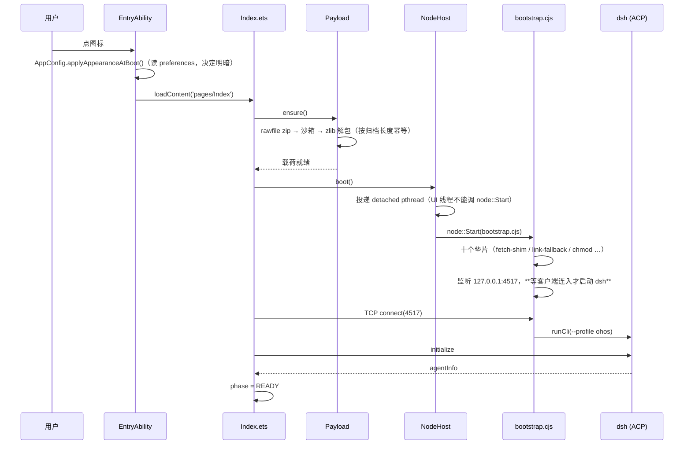
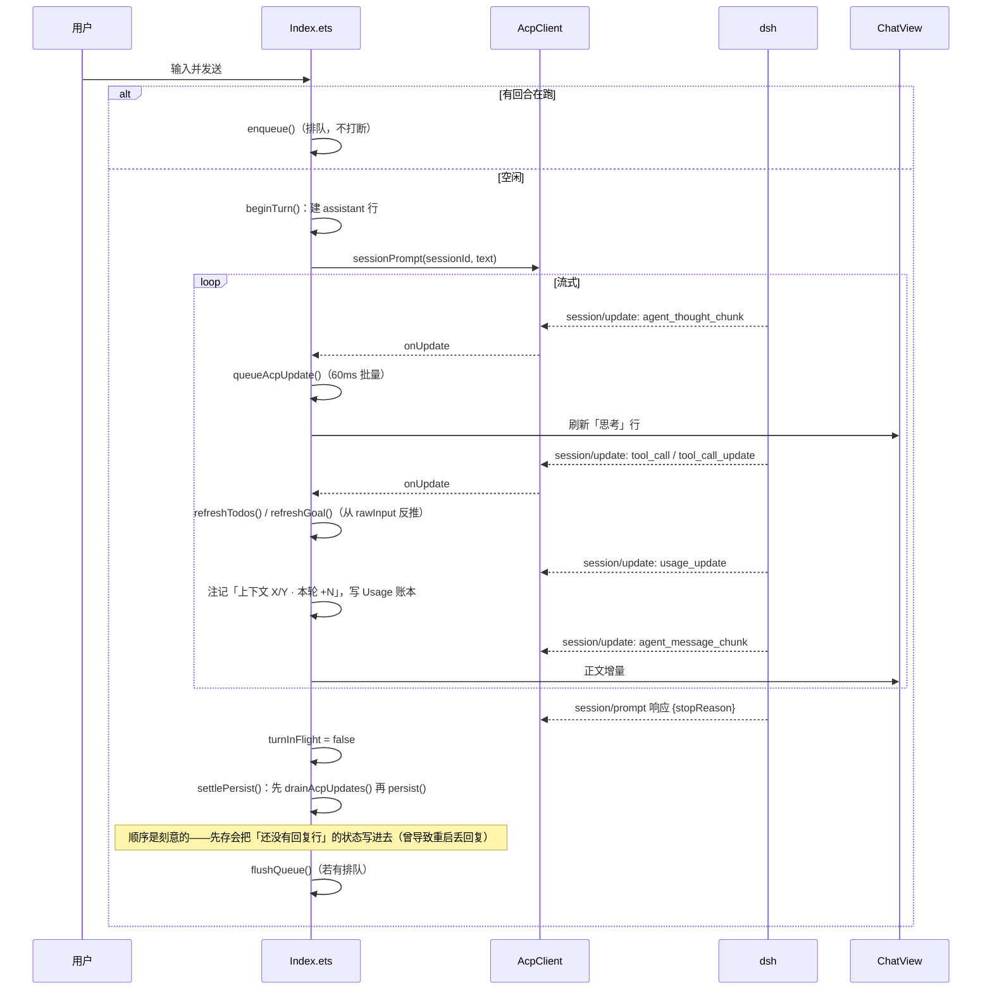
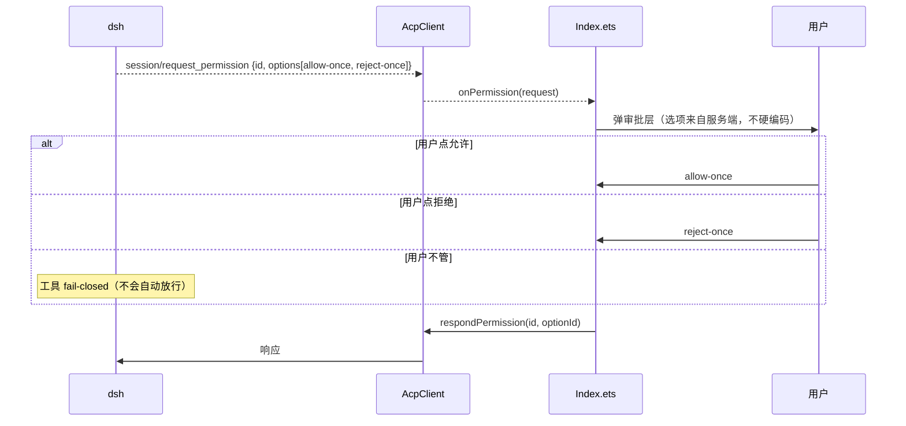
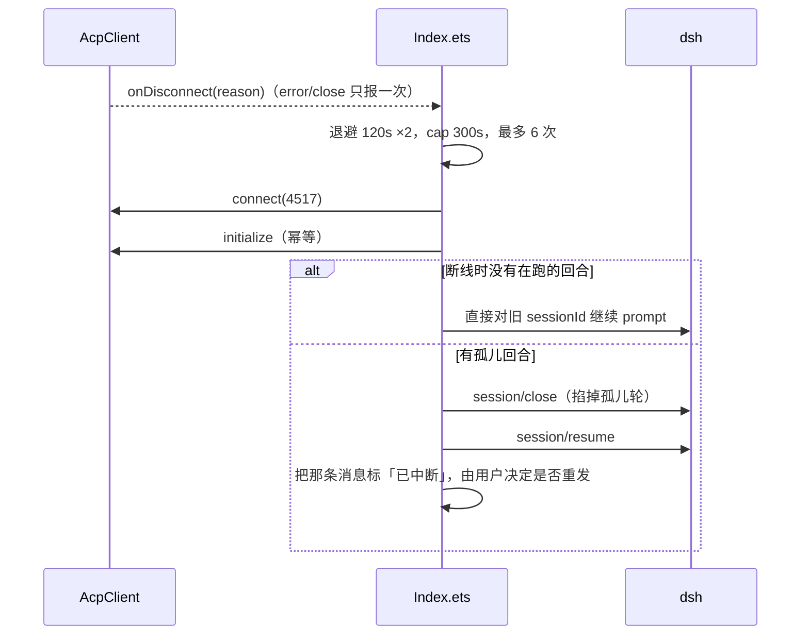
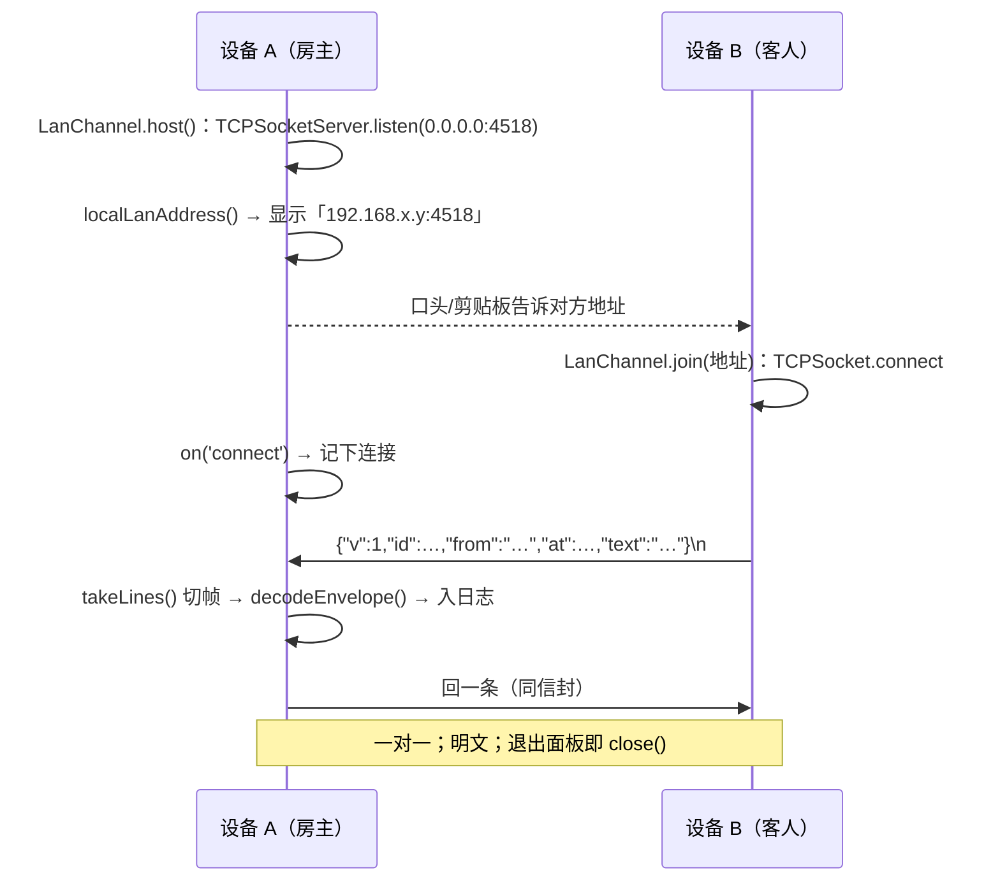
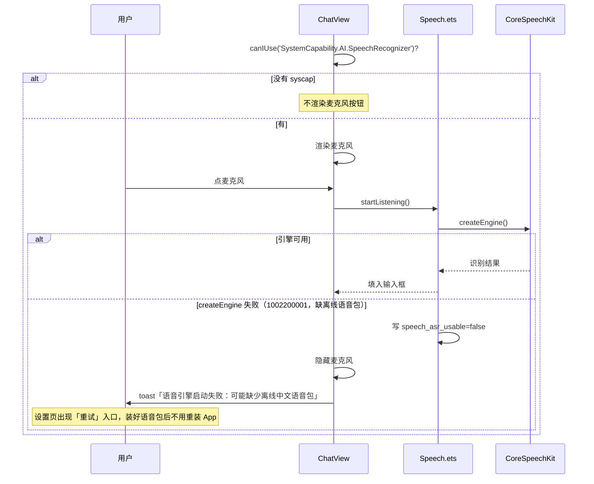

# API 与时序（2026-11-19）

> 回答两个问题：**这个项目现在实现了什么**、**有没有 API 文档和时序图**。
> 结论先说：**功能有，内部模块 API 有，但从来没有一份集中写的 API 文档；时序图只有
> `ARCHITECTURE.md` 里那段 ASCII 的启动步骤，没有可渲染的图。本文补齐这两样。**
>
> 现有文档的分工：`ARCHITECTURE.md`（分层与协议面）、`BOOT.md`（启动链路到函数级）、
> `SPIKE-ACP.md`（ACP 实测矩阵）、`DSH-GO-PARITY-V2.md`（对外能力对照）。
> 本文是**接口清单 + 时序图**，不重复它们的叙述。

---

## 一、实现了什么（按能力域）

| 域 | 已实现 | 代码位置 |
|---|---|---|
| **运行时** | 载荷解包 → dlopen `libnode.so` → 同进程 Node v24.2.0 → 回环 TCP 桥 → dsh | `host/NodeHost.ets`、`host/Payload.ets`、`host/bootstrap.cjs` |
| **协议** | ACP（9 方法，默认路径）+ SDK（5 方法，legacy）双 profile，可在设置里切 | `model/AcpClient.ets`、`model/DshClient.ets` |
| **对话** | 流式回答/思考、工具轨迹（6 类 + 子代理）、排队插话、引用、重答、停止 | `pages/Index.ets`、`view/ChatView.ets` |
| **投影** | 待办、目标、上下文占用、每轮 token、子代理计数（全部从 `tool_call` 反推，无协议改动） | `model/TodoModel.ets`、`GoalModel.ets`、`Usage.ets` |
| **会话** | 新建/切换/删除/重命名、项目分桶、搜索（标题 + 缓存转录）、置顶/归档/多选/未读 | `model/ChatModel.ets`、`view/SessionRail.ets` |
| **产物** | 文件 chip、产物面板、内嵌预览、全屏查看、存相册、分享卡、Markdown 导出 | `view/FileViewer.ets`、`common/Gallery.ets`、`ShareCard.ets`、`model/Export.ets` |
| **回撤** | 每轮文件快照 → 恢复到该轮之前（含删除该轮新建的文件） | `model/Rollback.ets` |
| **外观** | 明暗三档（启动期应用）、字号四档、六套强调色 | `common/Theme.ets`、`Typography.ets`、`common/AppConfig.ets` |
| **系统** | 通知、桌面快捷方式、语音输入/朗读（引擎缺包时降级）、本地模型扫描、密钥热更新 | `common/Notify.ets`、`Speech.ets`、`ReadAloud.ets`、`LocalModel.ets` |
| **互联** | 同一 WiFi 直连（TCP）、WebSocket 中继、剪贴板、星闪/数据代理探针 | `common/Interop.ets`、`view/InteropSheet.ets` |

代码量：`entry/src/main/ets` 下 **42 个 `.ets`，15,447 行**。

---

## 二、对外 API（协议面）

### 2.1 ACP（默认路径，`DSH_PROFILE=acp`）

客户端 → 运行时：

| 方法 | 入参 | 出参 | 备注 |
|---|---|---|---|
| `initialize` | `{protocolVersion:1, clientCapabilities}` | `{protocolVersion, agentInfo, agentCapabilities, authMethods}` | 可重复调用（重连后再发一次不报错） |
| `session/new` | `{cwd, mcpServers}` | `{sessionId, configOptions}` | 服务端生成 id |
| `session/resume` | `{sessionId, cwd, mcpServers}` | 同上 | 对活跃会话报 `session is already active` |
| `session/list` | — | 已关闭/已持久化会话 | 活跃会话不在其中 |
| `session/close` | `{sessionId}` | — | 关闭后才进 list |
| `session/prompt` | `{sessionId, prompt:[{type:'text',text}]}` | `{stopReason}` | 一次只允许一轮；inflight 时拒绝 |
| `session/set_config_option` | `{sessionId, configId, value}` | `{configOptions}` | `model` 的 value 是 **JSON 数组字符串** |
| `session/cancel` | `{sessionId}` | **无响应（通知）** | 当请求发会 `Method not found` |

服务端 → 客户端：

| 通知/请求 | 载荷 | 客户端处理 |
|---|---|---|
| `session/update` | `agent_message_chunk` / `agent_thought_chunk` / `tool_call` / `tool_call_update` / `usage_update` | `Index.handleAcpUpdate` |
| `session/request_permission` | 两选项 `allow-once` / `reject-once` | 审批弹窗；不答 → 工具 fail-closed |

**客户端封装**（`model/AcpClient.ets`）：

```ts
connect(port) / initialize() / sessionNew(cwd) / sessionResume(id, cwd)
sessionPrompt(id, text) / sessionPromptBlocks(id, blocks) / sessionCancel(id)
sessionClose(id) / setConfigOption(id, configId, value) / respondPermission(id, optionId)
getState() / getServerInfo() / getImagePrompts() / close()
// 回调：onUpdate / onPermission / onDisconnect
```

### 2.2 SDK（legacy，`DSH_PROFILE=sdk`）

5 个请求 + 4 个通知，见 `ARCHITECTURE.md` §协议面。差异：`session.event` 是**全运行时**事件流（客户端按
`sessionId` 过滤），且没有审批通道。

---

## 三、内部模块 API（导出符号）

纯函数为主的模块（都有单测覆盖）：

| 模块 | 主要导出 |
|---|---|
| `model/Protocol.ets` | `encodeRequest`、`decodeFrame`（SDK 帧编解码） |
| `model/AcpProtocol.ets` | 34 个：`encodeNotification`、`findConfigOption`、`flattenChoices`、`textOfUpdateContent`、`toolTextOfUpdateContent`… |
| `model/TodoModel.ets` | `isTodoTool`、`todosFromJson`、`todosFromRaw`、`completedCount`、`activeTodo`、`todoSummary` |
| `model/GoalModel.ets` | `isGoalTool`、`goalFromJson`、`goalStatusLabel`、`goalSettled` |
| `model/Usage.ets` | `dayKey`、`mergeUsage`、`usageTotal`、`compactCount` |
| `model/Rollback.ets` | `isWriteTool`、`writePathsOf`、`SnapshotStore`、`FileChange`、`FileTouch`、`RollbackReport` |
| `model/Export.ets` | `exportFileName`、`transcriptMarkdown` |
| `common/SecretMask.ets` | `hasSecret`、`maskSecrets`、`secretCount` |
| `common/Typography.ets` | `fontScaleOf`、`fontIdOf`、`scaled`、`FONT_LEVELS` |
| `common/Theme.ets` | `accentOf`、`themeIdOf`、`themeLabelOf`、`ACCENTS` |
| `common/TimelineNode.ets` | `toolKindOf`、`kindVerb`、`kindAccent`、`kindGlyph`、`statusLabel`、`NodeKind` |
| `common/Interop.ets` | `makeEnvelope`、`encodeEnvelope`、`decodeEnvelope`、`takeLines`、`keepRemainder`、`probeChannels`、`LanChannel`、`WebSocketChannel`、`ClipboardChannel`、`probeNearLink`、`probeDataShare` |
| `common/WorkspaceFiles.ets` | `listWorkspaceFiles`、`matchWorkspaceFiles` |
| `common/AppConfig.ets` | `load`、`save`、`saveAccent`、`saveAppearance`、`saveFontLevel`、`applyAppearanceAtBoot` |
| `view/ChatView.ets` | `refsFromText`、`segmentsOf`、`renderBlocks` |

---

## 四、时序图

### 4.1 冷启动



### 4.2 一轮对话（ACP）



### 4.3 审批



### 4.4 断线重连



### 4.5 互联：同一 WiFi 直连



### 4.6 语音输入（含降级）



---

## 五、文档缺口（诚实清单）

| 缺什么 | 现状 |
|---|---|
| **可渲染的时序图** | 本文首次提供（mermaid）。此前只有 `ARCHITECTURE.md` 的 ASCII 步骤 |
| **集中的 API 参考** | 本文首次提供模块级清单；此前只有 `ARCHITECTURE.md` 的协议表和 `.d.ts` 级的类型 |
| **`ARCHITECTURE.md` 已过时** | 它把 SDK 写成主路径（2026-10 口径），现在默认是 ACP。**读协议请看 §2.1 与 `SPIKE-ACP.md`** |
| **无 OpenAPI / 无代码内 TSDoc 生成** | ArkTS 没有成熟 doc 生成链，接口说明只能手写（即本文） |
